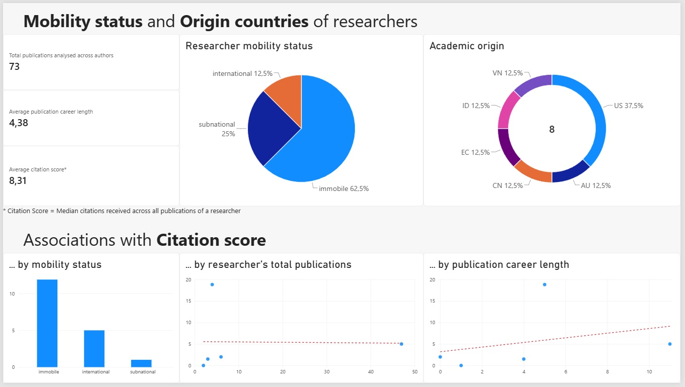

# OpenAlex Scholarly Migration EDA

The project provides exploratory insight into scholarly migration patterns based on publication metadata from the OpenAlex bibliometric dataset (Priem et al. 2022). Researchers are classified into immobile, subnationally mobile, and internationally mobile groups of scholars. Covariates include: origin location, number of publications, median citations received, and publication span.

A research-impact performance indicator, the 'Citation score' (Median citations received per author across their observed publications), and its associations within the data can be explored using a Power BI dashboard. The dashboard is under development and will be released in a later update (`/images/dashboard_example.jpeg`, shown below, is a preliminary layout suggestion).

Disclaimer: The mobility status of individual researchers is inferred through their publication and affiliation histories and is not directly observed (Moed & Halevi 2014). This method is reliable in aggregate, while the accuracy for individuals varies (Aman 2018).



## Tech Stack

-   **Python:** Programming language
-   **PostgreSQL:** Database
-   **PyAlex:** OpenAlex API
-   **uv:** Dependency manager
-   (**Power BI:** Dashboard)

## Features

-   Reproducible, configurable, and scalable data acquisition
-   Standardised data cleaning and preprocessing

## **Filetree and Pipeline**

```         
Filetree

├── /images
|   └── dashboard_example.jpeg # Example power BI dashboard preview
├── /scripts
|   ├── 1_prepare_powerbi.sql # Clean and adjust data
|   ├── 2_metadata.sql # Create a metadata table
|   ├── 3_recode_country.sql # Recode the origin location variable
|   └── api_to_db.py # Retrieve/format data and ingest in PostgreSQL
├── .gitignore
├── config.yaml # Insert API-key and adjust database parameters
├── pyproject.toml # for uv/virtual environment
├── README.md
└── uv.lock # for uv/virtual environment
```

```         
Pipeline

OpenAlex API → PostgreSQL → Power BI
```

### Requirements

-   Python (3.14)(<https://www.python.org/>)
-   uv (<https://docs.astral.sh/uv/>)
-   OpenAlex API key (free: <https://developers.openalex.org/guides/authentication>)
-   PostgreSQL and a database (<https://www.postgresql.org/>)

## Replication instructions

1)  Install Python 3.14, uv, and PostgreSQL

2)  Create the PostgreSQL database (e.g. in pgAdmin 4)

3)  Adjust `config.yaml` (API key, sample size (total researchers requested by the API), and database credentials)

4)  Activate virtual environment (uv) and install Python dependencies

```         
  uv sync
```

5)  Run `api_to_db.py` to acquire and ingest the data

```         
  python scripts/api_to_db.py
```

6)  Run the `.sql` scripts in order

7)  Connect Power BI to PostgreSQL and create your dashboard

## Sources

-   OpenAlex data: <https://doi.org/10.48550/arXiv.2205.01833> (Priem et al. 2022)

-   PyAlex: <https://github.com/J535D165/pyalex>

-   PostgreSQL: <https://www.postgresql.org/>

-   GitHub repository layout partly based on: <https://github.com/Sumonta056/Readme-Template>

## Literature

-   Aman, V. (2018). Does the scopus author id suffice to track scientific international mobility? A case study based on leibniz laureates. Scientometrics, 117(2), 705–720. <https://doi.org/10.1007/s11192-018-2895-3>
-   Moed, H. F., & Halevi, G. (2014). A bibliometric approach to tracking international scientific migration. Scientometrics, 101(3), 1987–2001. <https://doi.org/10.1007/s11192-014-1307-6>
-   Priem, J., Piwowar, H., & Orr, R. (2022). *OpenAlex: A fully-open index of scholarly works, authors, venues, institutions, and concepts*. <https://doi.org/10.48550/arXiv.2205.01833>
